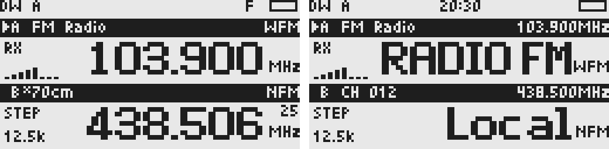

<div align="center">

# UVK6 Reborn

**A new radio experience for Quansheng UV-K6 & UV-K1.**

Tune by band, frequency, and mode. Keep your channels, monitor multiple slots, and make the most of your radio.

[](https://github.com/lsongdev/uvk6-reborn/actions/workflows/c-cpp.yml)
[](LICENSE)
[](#supported-hardware)

[Web Flasher & Device Tools](https://lsong.org/uvk6-reborn/) · [User Manual](docs/user-manual.md) · [Build & Development](docs/development.md) · [Design](docs/design.md) · [Firmware Builds](https://github.com/lsongdev/uvk6-reborn/actions/workflows/c-cpp.yml)



<sub>Rendered with the firmware UI and example data. Documentation is currently in Chinese.</sub>

</div>

## Features

| Everyday radio | Explore & monitor |
| --- | --- |
| **Four working slots** — independent VFO memories and channel selection | **Multi-slot monitoring** — compatible receiver paths, one speaker output |
| **200 channels** — names, RX/TX settings, persistent storage | **Seek & spectrum** — find stations and inspect nearby signals |
| **NFM transmit** — shift, split, CTCSS/DCS, optional TX tail signaling | **Frequency capture & RX tone scan** — identify a carrier or receive tone |
| **Broadcast reception** — WFM, RDS text and clock on SI4732 | **AM & SSB** — SSB requires SI4732 hardware and an external patch |
| **Display controls** — brightness, idle backlight, battery views | **K1 USB CDC** — diagnostics and storage backup over a data cable |

Development is active. Basic listening and operation have been confirmed on the development units; full RF measurements, RX tone identification and TX tail interoperability remain ongoing. See each board's hardware record for the evidence and limits.

## Supported Hardware

| Build | MCU | External storage | Radio / broadcast |
| --- | --- | --- | --- |
| **UV-K6 + SI4732** · primary development unit | DP32G030 | 512 KiB I²C EEPROM | BK4819 / SI4732 modification |
| **UV-K6 + BK1080** · build variant | DP32G030 | 512 KiB I²C EEPROM baseline | BK4819 / BK1080 |
| **UV-K1 MiniKong** · second target | PY32F071 | 2 MiB SPI NOR | BK4829 / BK1080 |

The default K6 build targets the SI4732 modification. Use `ENABLE_SI4732=0` for BK1080 hardware. K1 always uses BK1080. Other EEPROM sizes and board variants are not validated targets. **K1 and K6 images are not interchangeable.**

## Get Started

Use the [browser workbench](https://lsong.org/uvk6-reborn/) to flash firmware,
connect the running radio, read diagnostics and download storage backups.
It requires desktop Chrome or Edge; flashing both boards uses a K-type UART
programming cable. The buildless Preact + htm source is in [website/](website/).

1. Read the [flashing and backup instructions](docs/user-manual.md#1-刷入固件与首次使用), and preserve your radio's factory calibration.
2. Download the matching artifact from a successful [Firmware build](https://github.com/lsongdev/uvk6-reborn/actions/workflows/c-cpp.yml) run: `uvk1-bk1080`, `uvk6-bk1080`, or `uvk6-si4732`.
3. Flash the **raw `.bin`** with `tools/flash.py`, then initialize the configuration when prompted.

To build locally, install ARM GNU tools, Python 3 and `crcmod`:

```sh
git submodule update --init --recursive
python3 -m pip install crcmod

# UV-K6 with the SI4732 modification (default)
make
make flash PORT=/dev/cu.usbserial-1420

# UV-K6 with BK1080
make ENABLE_SI4732=0
make flash ENABLE_SI4732=0 PORT=/dev/cu.usbserial-1420

# UV-K1 MiniKong
make BOARD=uvk1
make BOARD=uvk1 flash PORT=/dev/cu.usbserial-1420
```

Replace the port with your device's port. Hold PTT while powering on to enter the bootloader. Both boards use a K-type UART programming cable; K1 USB CDC is available in the running application. See [Development](docs/development.md) for image formats, recovery, build switches and host regressions.

## Documentation

| Guide | Contents |
| --- | --- |
| [User Manual](docs/user-manual.md) | Flashing, screen tour, keys, illustrated menus, channels, RX and TX ranges |
| [Design](docs/design.md) | Tuning, slot monitoring, audio ownership, TX lifecycle, storage formats and roadmap |
| [Development](docs/development.md) | Build matrix, tools, architecture, memory budgets and validation |
| [UV-K6 Hardware](docs/hardware-uvk6.md) | Primary unit, controls, EEPROM layout, calibration and listening records |
| [UV-K1 Hardware](docs/hardware-uvk1.md) | Board differences, USB, SPI storage, calibration and hardware records |
| [Datasheets](docs/datasheets/README.md) · [Resources](resources/README.md) | Chip references, original sources and external SSB patch provenance |

## Contributing

Run `sh tests/run.sh` for host regressions. Build both boards when changing shared HAL or drivers, and keep shared features within K6's **60 KiB Flash / 16 KiB RAM** budget. Include the board, build options and validation results with your changes; update the relevant guide when behavior changes.

## Credits

- [fagci / Hawk5](https://github.com/fagci/hawk5) — the upstream firmware this project evolved from.
- [DualTachyon](https://github.com/DualTachyon/uv-k5-firmware) and [Egzumer](https://github.com/egzumer/uv-k5-firmware-custom) — radio driver and protocol implementation references.
- [F4HWN](https://github.com/armel/uv-k1-k5v3-firmware-custom) and [ApeX](https://github.com/N7SIX/UV-K1Series_ApeX-Edition_v7.6.0) — UV-K1 board and BK4829 implementation references.
- [PU2CLR SI4735](https://github.com/pu2clr/SI4735) and Vadim Afonkin — external SSB patch provenance, detailed in [Resources](resources/README.md).
- [ARM CMSIS](https://github.com/ARM-software/CMSIS_5), muwerk fonts and the original contributors whose notices remain in the source.

## License

Project code is licensed under the **GNU Affero General Public License v3.0**. See [LICENSE](LICENSE). Third-party files and external resources retain their own notices and terms; the SSB patch is separate from the firmware license. Source and release preparation notes are maintained in [Development](docs/development.md#8-公开发布准备).
