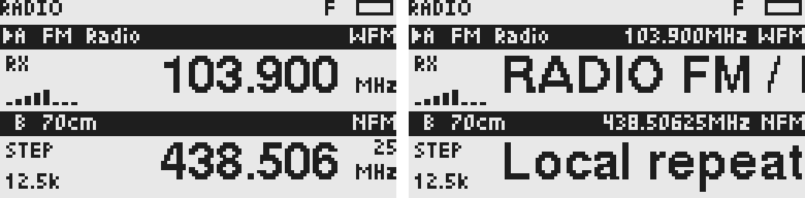
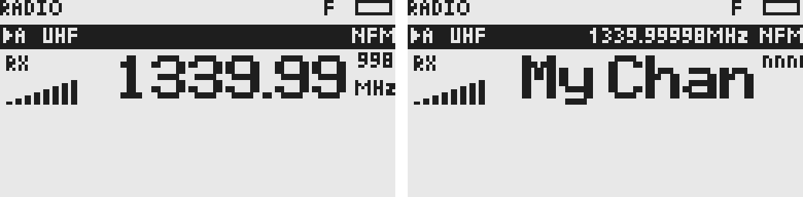

# 设计文档

更新于 2026-10-14。本文集中说明当前产品规则、数据模型与功能取舍；操作见[用户手册](user-manual.md)，目录、构建和验证见[开发文档](development.md)，芯片规格与设备证据见[硬件事实](hardware-uvk6.md)。文末明确列出未实现规划，历史单 VFO、A/B 和旧存储格式不再作为当前规格。

## 1. 产品原则与概念

用户围绕频段、频率和明确解调模式操作。接收路径由底层自动选择，模式始终是 NFM／WFM／AM／LSB／USB，没有 Auto 解调模式。广播与对讲使用同一套模型，F→0（FM）作为模式入口，不单设广播快捷键。RX 与 TX 独立计算，能接收或使用 BK 不授予发射资格。

| 概念 | 职责 |
| --- | --- |
| RadioSlot | A–D 工作位置；保存 VFO 当前频率、九个频段记忆、TX 设置、来源与 MR 编号 |
| RadioSource | VFO 直接调频，或 CHANNEL 从存储频道解析参数 |
| RadioBand | 内置频段匹配、快捷顺序及共享预设，和接收芯片不同 |
| RadioParameters | 明确模式、步进 Hz、带宽 Hz、静噪、RX Tone |
| RxPlan | 接收设备、实际频率 Hz、完整 RX 参数 |
| TxConfig／TxPlan | 用户发射意图／校验后实际发射方案 |
| Receiver | 硬件此刻应用的方案、测量、音频开关 |
| RxRuntime | 应用已提交的方案以及调谐失败恢复状态 |

Slot 最多保存四个、启用 1–4 个、同时显示两个。启用数量与显示行数、物理接收器数量分别处理。减少数量保留隐藏参数，选中项被隐藏时回到 A。MR 只生成临时有效视图，不覆盖 Slot 的 VFO 记忆；恢复 VFO 时取原状态。

控制器常驻系统主循环，页面只是操作与显示。翻菜单不会停止接收；输入草稿、F 前缀、菜单光标属于页面。公共 API 按当前上下文设计，同步更新调用方，不增加旧接口包装。

## 2. 统一调谐与频段预设

共享模型、配置和频道记录都使用整数 Hz，芯片 10 Hz 单位和带宽索引留在 HAL／驱动。32 位 Hz 可容纳当前 150 kHz–1.34 GHz 输入范围；范围匹配不承诺任意组合能接收。

频段重叠时取最窄匹配，快捷顺序单独定义。各 Slot 的频段记忆独立，预设共享。模式、步进、带宽、静噪和 RX Tone 是预设；发射设置是 Slot／频道意图，和预设分开。

- 手动切频段恢复目标频段上次频率并应用共享预设。
- 同频段调频保留当前覆盖，跨频段采用目标预设；下一次步进使用新参数。
- 切 Slot 和启动恢复完整已保存参数，不重新套预设。
- 临时覆盖不会自动改预设。Reset to defaults 恢复 RX 预设，不改 RX 频率和 TX。
- 预设编辑采用草稿，Use current／Defaults 不立即保存；Save 校验、写入成功后才提交，下次进入频段应用。

调谐入口统一为规划→应用→提交。先匹配频段、确定参数、生成 RxPlan，再经 RX_RuntimeTune 应用；成功才提交 Slot、来源、选择或保存。失败尝试恢复原方案，恢复失败则静音并清活动归属。Seek／Watch／FC 可临时接管硬件，不是新的 RadioSource，不保存中间候选。

VFO 数字输入为 MHz，MR 数字输入为频道编号 CH，两类草稿均确认后才调谐。用户输入可请求近似频率，但量化改变时要展示实际值并确认；更换芯片本身不需确认。Slot／MR 切换和守听要求 TUNING_ExactPlan 精确表示。量化后跨到其他频段返回 Band boundary，不能用错误预设提交。不可用模式不静默替换，失败目标不伪装为实际接收状态。

| 接收组合 | 软件策略 | 分辨率 |
| --- | --- | --- |
| NFM，BK 支持范围 | 固定 BK4819 | 10 Hz |
| WFM，64–108 MHz | 优先 SI4732，否则探测到的 BK1080 | SI 10 kHz；BK1080 100 kHz |
| AM，≤30 MHz 且有 SI | SI4732 | 1 kHz |
| AM，其余 BK 支持范围 | BK4819 AM 实现 | 10 Hz |
| LSB／USB，≤30 MHz | SI4732＋受信任补丁 | 10 Hz |

BK 支持范围按模型为 18–660／840–1300 MHz。SI 的软件扩展范围和补丁能力须与厂家基本规格分开。WFM 不回退到 BK 窄带 FM；SSB 不回退到 BK 伪 SSB。航空 8.33 kHz 步进按 25 kHz/3 栅格计算并量化到 10 Hz，界面显示真实载波频率，不是 ICAO 频道名称。

同芯片仅频率改变时可走快速路径；TX、FC 或模式变化后失效缓存，完整重配，不能因为恢复同频而跳过 RX_ENABLE。总线、芯片等待必须有界，阻塞调用结束后才开始稳定计时。

## 3. UI 与按键规则

128×64 屏幕顶部状态栏 8 px，卡片各 128×28，放在 y=8／36。单槽只画一张；四槽分页 A/B、C/D，三槽选 C 时显示 B/C。后台音频不会改变选中箭头或页码。

| 卡片区域 | 布局 |
| --- | --- |
| 顶部 8 px | 黑底：箭头、A–D、预设差异 *、频段／频道、右对齐模式 |
| 正文左侧 x=0–27 | STEP、RX＋阶梯信号、TX＋功率、SEEK 或故障 |
| 正文主文本 x=30–112 | 频率或名称，右边缘固定 x=113 |
| x=113–114 | 间隔 |
| x=115–127 | 上半显示放不下的尾部，下半显示单位／名称状态下的模式 |

频率和名称都用同一中字放大两倍加粗，没有两套数字字形。完整频率按实际值省略无意义尾零；小字尾数补足精度，不强制三位、不舍入。低于 1 MHz 使用 kHz。有名称则正文显示名称、横条右侧显示完整紧凑频率、模式下移；无名称显示频率，输入和 Seek 强制频率。

UI_RadioCardRender 是纯绘制、无动画、无持久状态，超出空间裁剪。横条文本优先级：临时提示→短时 RadioText→频段／频道号。有名称时提示／RadioText 也占用横条频率位置，正文保留名称。提示约 2.5 秒；RadioText 变化后显示 10 秒，同段重复不续时。Slot 菜单和设置页面的局部反馈目前使用各自标题／提示位置。

主屏幕与菜单共用状态栏；电池右对齐，其余图标依次排列，标题在剩余宽度内裁剪。RX／信号只属于实际开音频的项，相对强度不当作校准 S 值。

副标统一短按 F→目标键，数字短按仍输入；不叠加数字长按副标入口。F 是一次性前缀，执行／取消／3 秒超时退出，长按 F 专属锁键。菜单、输入和功能按键优先于全局快捷键。默认侧键 1 切频段、侧键 2 切模式；当前绑定和物理标记分别见手册与硬件事实。

Slot 菜单不用分组标题或缩进，RX 项连续、TX 项连续，末尾为 Reset to defaults、Save as channel。五行列表中项目左、数值右，选中项反白，子菜单提示右对齐。全局设置只对确有下层项目的入口增加层级，About 固定根菜单最后。

## 4. 多 Slot 守听与音频归属

两个及以上 Slot 自动参与，不保存守听总开关或各项资格。去重精确 RxPlan；不足两个独立来源时保持普通选中项接收。常驻源和事件源按行为分类：

| 类型 | 定义 | 调度 |
| --- | --- | --- |
| 常驻源 | SI4732／BK1080 方案，或 SQ0 的 BK 方案 | 只留一路，选中常驻源优先，否则第一路 |
| 事件源 | SQ>0 的 BK 方案 | 依次检查，首个确认信号占用扬声器 |

不同芯片各自工作；SI 常驻源（WFM／AM／LSB／USB）开始时准备一次，BK 轮询不反复调谐 SI，也不重载 SSB patch。事件占用音频时只静音 SI，结束并经过停留时间后恢复 SI 音频；WFM 仍可读 RDS。一路事件讲话期间停止检查其他 BK 目标，不允许事件互相打断；选中项没有事件音频特权。多个 SI Slot 共用一颗芯片，只保留一路常驻源，不在广播和 SSB 或多个 SSB 频率间轮询。

BK 常驻源和事件共用一颗 BK，必须切频轮询：检查完一圈回常驻频率播放 1 秒，再开始下一圈。选中事件优先作为开始检查对象，但不无限优先于正在讲话的其他事件。

| 时序 | 当前工程参数 |
| --- | ---: |
| BK 稳定等待 | 180 ms |
| 信号二次确认 | 80 ms |
| 占用期间采样 | 50 ms |
| 信号结束静音停留 | 2 s，等回复 |
| BK 常驻源每圈放音 | 1 s |
| 失败冷却／重试 | 2 s |
| 手动 RF 修改后恢复守听 | 2 s，连续修改顺延 |

每个无信号事件检查约 200 ms，N 个目标的发现延迟随 N 增长，短呼叫可能漏掉。讲话期间其他事件不可检查。常驻源也在 BK 时必有轮询断音；SI 广播不会因为 BK 轮询改变自身调谐。门槛和时延是工程默认值，待实机测量。

WATCH_Owner 表示扬声器归属，selectedSlot 表示用户操作归属。临时守听不改用户频率、来源、选择、TX 和 EEPROM。翻菜单、输入草稿、确认及保存页面不暂停；实际调谐、Slot／来源切换、改 RX、Seek、PTT 才暂停并恢复相应方案。FC 只借用 BK，暂时移出 BK 目标并保留广播音频；检测期间控制器暂停 RDS 轮询。

PTT 在事件讲话或 2 秒回复窗口内使用该事件 Slot 的有效 TX 设置回话；其他时候使用选中项。拒绝原因不触发退回其他 Slot 发射。回话不移动箭头，松键恢复回话频道，之后恢复守听。

## 5. 发射模型与半双工恢复

TxConfig 独立保存 enabled、power、shift、offset_hz、split_hz、tone。Shift=Off 跟随 RX，+／- 计算 RX±频差，Split 用指定频率（0 表示跟随 RX）。TX_MODEL_Frequency 统一解析，防止溢出；实际 TX Hz 决定范围与校准，不借用接收频段。

TX_MODEL_Plan 校验 TX Enable、NFM／BK、板级能力、两个不相连的范围、校准功率档、10 Hz 栅格和亚音。软件范围为 [136,174)／[400,470) MHz，不采用芯片全部接收范围。MR 使用频道 TX 配置，不能通过菜单隐式写回。

PTT→确定选中或回话对象→停止守听并恢复对象方案→必要时等待稳定检测忙信道→规划 TX→冻结 RX、静音、PA 关闭→配置语音／亚音／偏置→复查物理 PTT 与电压→最后开启 PA。

松键、TOT 或供电异常先关 PA，再停止 TX DSP、失效 BK 接收缓存、完整恢复 RX；恢复失败进入 FAULT 并静音。TOT 默认 120 秒，到期后必须松键才可重试。物理松键、电压和 TOT 由系统最高优先级更新，不依赖页面刷新或按键释放队列。电压边界当前 6–9 V，没有温度保护或独立硬件 PA 看门狗；RF 输出和最长阻塞时延需要实测。

默认 ENABLE_TX=1；仅接收变体无 PA 开启能力。每个 Slot TX Enable 默认 Off。寄存器命令发出和 Ready 状态都不表示射频测量已通过。校准地址集中维护于硬件事实。

## 6. RDS、Seek 与 FC

RDS 链路为 SI 命令→HAL 的 RdsPacket→纯解析器／轮询器→Slot 标签→卡片。支持 PI、0A/0B PS、2A/2B RadioText 和 4A 时钟（CT）；每个段须两次一致，PS 四段齐全才发布，RT 收齐结束符前连续段或全部段才发布。块错误、PI 改变、RT A/B／格式改变、溢出均有明确清理策略。CT 只用 C、D 块无纠错的组，按电台的半小时偏移换成当地时间；两组相同或相差一分钟才采用，MJD 为 0、时分越界的忽略。控制器记下采用时的运行计时，状态栏居中显示 时:分，不显示日期；没有 RTC，关机即丢失。

进入 SI WFM 先等 300 ms、清 FIFO，每 100 ms 最多读四组；读失败停止本轮。连续 15 秒无有效同步数据则过期。实际重调谐重置解析器，单纯广播／BK 音频路由不重置。缓存按 Slot、频率隔离，不持久化；MR 正文优先频道名。ASCII 扩展映射为 ?，控制字符转空格，RT 回车结束；不实现完整字符集、RT+、时钟、AF。命令与 BLE 错误等级依据 [Skyworks AN332](https://www.skyworksinc.com/-/media/Skyworks/SL/documents/public/application-notes/AN332.pdf)，分组文本参考 [AN243](https://www.skyworksinc.com/-/media/Skyworks/SL/documents/public/application-notes/AN243.pdf)。

Seek 只在选中 VFO 的当前频段／模式内向前搜索、回绕一次。SI 使用原生 Seek，BK／BK1080 软件步进，独立检测信号，不能把 SQ0 音频常开视为电台。中间候选只改硬件；找到后用统一事务提交一次。取消、失败、无台恢复 origin，不保存。SSB 不 Seek。

FC 仅 VFO、BK 频率检测。core/capture 接收 BUSY／INVALID／SAMPLE，同滤波范围两次差≤3000 Hz 采用最新值；Auto 每范围最多两次尝试再轮换，单次尝试 500 ms、轮询 20 ms，不设会话超时。MENU 可采用最新有效读数；EXIT 取消。候选必须精确为 NFM／BK 方案，采用后关闭 TX Enable、清 RX Tone／频道绑定，成功才保存。停止检测需失效 BK 缓存，同频恢复也全配置。它不解码模式或亚音，不保证免于谐波误捕。BK 驱动通过 REG32 的 0x0245／0x0244 开启／关闭检测，REG0D 完成位及 REG0E 合成读数；参考 [Egzumer BK4819 实现](https://github.com/egzumer/uv-k5-firmware-custom/blob/main/driver/bk4819.c)，未知寄存器字段不当作厂家规格。

## 7. 配置、频道与全局设置

只维护当前 UVR2 **格式 9**；不读取旧格式或旧固件频道，不做兼容包装。固定字节编码与 C 结构分离，不能将枚举大小、位域或内存结构直接写入磁盘。

| 配置内容 | 字节数 |
| --- | ---: |
| UVR2 头部（标识、版本、频段／容量、序号、CRC） | 16 |
| 启用数量、选中项 | 2 |
| 四个 Slot（每个 174 B：来源与编号、当前／九频段记忆、TX） | 696 |
| 九个共享 RX 预设（各 10 B） | 90 |
| 全局偏好 | 21 |
| 合计已定义内容 | **825** |

整份记录填充至 1024 B，CRC32 覆盖整槽，两个副本轮换、按序号选择较新有效副本。写后分块回读，失败不报告成功；候选缓冲顺序复用，避免叠加多个 1 KiB 栈帧。无有效格式 9 时写锁定，用户确认初始化后写入默认配置。物理地址见硬件事实。

频道为 200 个稳定编号，每号两份 64 B，分别位于频道 A、B 两个存储区，含标记、8 位序号、编号、16 B 名称、RX、TX、CRC32。保存先写较旧的一份并回读，成功后才更新状态，再把同一记录镜像到另一份并回读；断电时要么保留旧版本，要么保留新版本。镜像使两份平时相同，因此在需要整扇区擦除的介质上，擦除一个区时同扇区的其他频道仍能从另一区取到当前内容，不会回滚。加载校验 CRC，坏副本回退；开机只读两份头部建立两个 25 B 位图。删除清两份标记，不能把它等同普通覆盖的断电原子性。名称保留 16 字节容量不表示已有中文编码／渲染。保存时优先预填原名称或广播 PS，没有名称时用紧凑频率；空名称也回退到频率。

全局偏好唯一运行态是 gDeviceConfig.preferences。可编辑项须有合法值、明确消费路径、生效时机和保存反馈；只存在旧字段不作为开放功能依据。显示即时应用，RX 工程项离开设置后重新应用；校准和 Reset prefs 保存成功后提交候选。普通修改 1500 ms 合并保存、失败 5 秒后重试，Pending 可因掉电丢失。

## 8. 后续规划

以下未实现，不作为用户手册入口：可配置侧键（方案见下）、自动锁键、按键音、NOAA／VOX／呼叫频道快捷键、完整 RDS 字符集和中文显示（评估见下）、频道扫描组、超过四个 Slot。

### 可配置侧键（已定方案，待实现）

- 两个侧键各开放短按、长按，共 4 项：Settings → Side keys → Side 1、Side 1 long、Side 2、Side 2 long，MENU／*／# 切换取值。
- 动作与 F 快捷键共用主屏幕的一张动作表（None、Band、Mode、A/B、VFO/MR、FC、Power、Reverse、Seek、Spectrum、Monitor），新增动作只改一处。
- 新增 Monitor：按住强开静噪，松开恢复，适合放在长按。
- 默认值保持现有习惯：Side 1 = Band，Side 1 long = Monitor，Side 2 = Mode，Side 2 long = Spectrum。
- 自定义只作用于主屏幕；FC、Seek、菜单、频谱页中侧键保持本地语义（如 FC 切换范围），键盘锁照常锁住侧键。
- 偏好增加 4 字节，配置格式 9 → 10。提供只认格式 9 的升级读取并补默认侧键，避免用户设置被重置。
- 预计 Flash 0.6–0.9 KB（Monitor 约 200–300 B）。

### 中文显示（2026-10-14 评估，待讨论）

目前没有任何来源会显示中文，字体和编码暂不定案，先记录评估结论。

- 字库放外部 EEPROM，经 tools/resources.py 作为资源安装（资源头、CRC、写后回读），位于 SSB 补丁之下；固件只读取并按需小缓存，不进 60 KiB Flash 和 16 KiB RAM，不直接移植其他设备的 SPI Flash 地址。频道区与 SSB 补丁之间约 430 KiB 可用。
- 卡片名称正文高 20 px、宽 83 px（x 30–113），现有英文为 muMatrix 8pt 放大两倍，大写约 10×14 px。

| 候选 | 授权 | GB2312 汉字 | 每字 | 全集 | 一行 | 观感 |
| --- | --- | ---: | ---: | ---: | ---: | --- |
| Fusion Pixel 8px 放大两倍 | OFL 1.1 | 6763／6763 | 8 B | 52 KiB | 5 字 | 与英文风格一致，复杂字（播、继、通）笔画丢失 |
| Fusion Pixel 12px（Ark Pixel 补字） | OFL 1.1 | 6620／6763 | 18 B | 118 KiB | 6 字 | 最清晰，比英文名称矮一截 |
| **GNU Unifont 16px（倾向）** | OFL 1.1／GPLv2+ 字体例外 | 6763／6763 | 32 B | 211 KiB | 5 字 | 高度与英文一致；汉字源自文泉驿 |

- Unifont 不加粗时纯中文清楚，但笔画 1 px，与 2 px 粗的英文混排（如 BG7中继、频道12）一重一轻。可选：中文加粗（密集字如“播”会挤）、或混排时英文改用较细字体（如 Unifont 自带 8×16 ASCII）。待真机观感决定。
- 超长：英文溢出部分以小字接在单位上方一列，中文无法缩入，只能截断（5 字）或滚动。
- 频道列表每屏 4 行、行高约 11 px，放不下 16 px；需另配 12 px 字体（再约 118 KiB），或列表改为 3 行以下。
- 编码：名称 16 B，GB2312 可存 8 字，UTF-8 只能存 5 字；GB2312 在容量和查表上都更合适。
- 中文来源决定实现顺序：① PC 工具经 UART 写频道名／导入频道表（最现实，可先在真机看效果）；② 机上拼音或区位码输入（工作量大）；③ RDS 国内基本不发中文，不考虑。建议先做 ①，真机确认字体、加粗与列表字号后再定方案。

增加 Slot 保存容量不增加同频芯片并行能力；更多 BK 事件仍需轮询，延迟与漏检增大。任何新 TX、资源写入或硬件参数必须保持明确边界，不能通过功能设置放开校准保护。

## 9. 源码依据

| 规则 | 当前实现 |
| --- | --- |
| 频段、模式、分辨率、跨频段步进 | [radio-model.c](../src/core/radio-model.c)、[tuning.c](../src/core/tuning.c)、[radio-state.h](../src/core/radio-state.h) |
| 来源和调谐提交、RDS 标签 | [radio.c](../src/radio/radio.c)、[receiver.c](../src/radio/receiver.c)、[rx-runtime.c](../src/radio/rx-runtime.c) |
| 页面按键、菜单与卡片 | [home.c](../src/ui/screens/home.c)、[slot-menu.c](../src/ui/screens/slot-menu.c)、[radio-card.c](../src/ui/radio-card.c) |
| 守听、回话、TX 许可 | [watch.c](../src/core/watch.c)、[tx.c](../src/radio/tx.c)、[tx-model.c](../src/core/tx-model.c) |
| Seek／FC／RDS | [seek.c](../src/radio/seek.c)、[capture.c](../src/radio/capture.c)、[rds.c](../src/core/rds.c)、[rds-receiver.c](../src/core/rds-receiver.c) |
| 编码、写保护与偏好 | [config-store.c](../src/store/config-store.c)、[channel-store.c](../src/store/channel-store.c)、[storage.h](../src/hal/storage.h)、[storage-layout.h](../src/boards/uvk6/storage-layout.h)、[preferences.c](../src/ui/screens/preferences.c)、[preferences.h](../src/store/preferences.h) |
