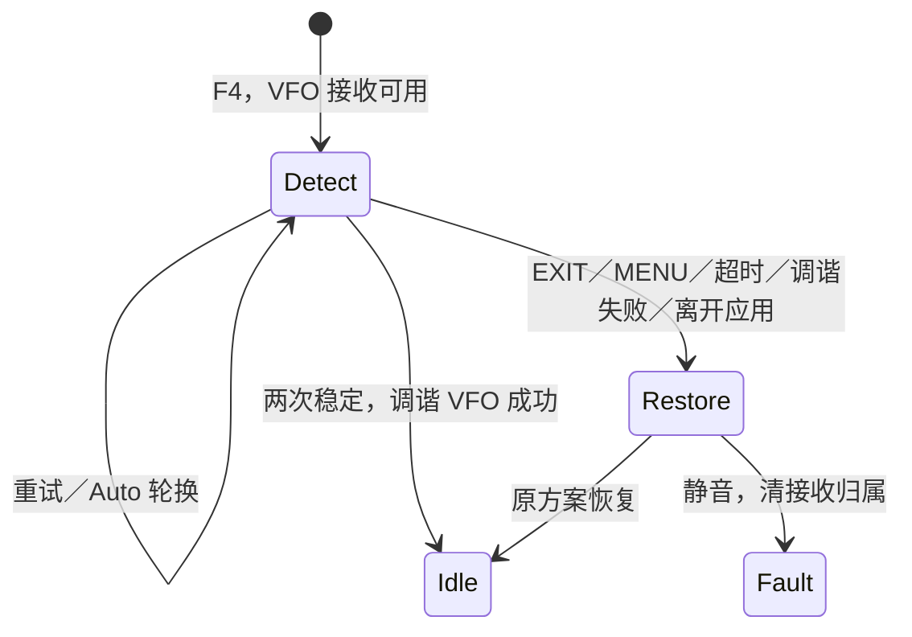

# FC 频率捕获

2026-10-13。首批已实现，入口为 **F → 4(FC)**。主机回归与 ARM 构建通过，尚未刷机验收。当前镜像 Flash **59,588 / 61,440 B**，余量 **1,852 B**；静态 RAM **7,796 B**，含栈／堆预留的链接 RAM **8,056 B**。EEPROM 容量及持久化格式不变。

## 操作

- 编译开关 `ENABLE_FC`（默认 1）；`make ENABLE_FC=0` 去掉 FC 全部代码，Flash 约省 1.3 KiB，`F → 4` 提示 `Not supported`。主机回归另以 `-DUVK6_ENABLE_FC=0` 做语法检查，CI 构建该变体。
- 仅在连续 VFO 来源启动，绑定入口时选中的 A–D；MR 中提示 `VFO only`。输入、菜单、确认、Seek、TX／PTT 等待释放期间保留原有独占操作。
- 默认 Auto，顶部显示当前检测范围。任一侧键循环 Auto → VHF → UHF → Auto，清候选并重新开始 15 秒会话。
- 检测中在当前 VFO 黑底状态条显示 `FC detecting`，正文保留频率；关闭音频，暂停双守听、普通静噪轮询与 RDS。
- 两次稳定结果后关闭检测器，**直接调谐入口选中的 VFO**（与手动输入频率相同）：NFM、TX Enabled 强制 Off、RX Tone Off，清原频道编号／名称草稿，请求一次正常保存。2026-10-14 起取消临时试听和 MENU 采用这一步；原频率不再保留，与手动输入新频率一致。
- EXIT 或 MENU 取消并恢复原方案；超时、调谐失败或离开应用同样停止检测并恢复。恢复失败则静音、清接收归属，提示 `RX error`。
- 检测期间屏蔽 PTT，不切 VFO，不修改其他项；取消和超时不写 VFO／频道／EEPROM。

**只能捕获近处的强载波**：检测器测的是天线上最强信号的频率，需要发射机就在附近（约数米内，例如另一台对讲机按下 PTT）。远处的广播电台或中继信号太弱，结果是 `FC timeout`，这不是故障。

首批不解码亚音、不判断未知信号的解调模式、不批量保存、不记录发现历史。采用时使用 NFM、12 kHz 带宽、12.5 kHz 步进、SQL4；捕获值保留 10 Hz 表示精度，不按步进取整。两次接近只代表稳定候选，仍可能是谐波或强信号误捕。

## 检测依据和参数

BK4819 REG32 写 `0x0245` 开启 0.2 秒频率检测，`0x0244` 关闭。REG0D bit15 清零表示完成；低 11 位与 REG0E 拼接成原始结果，按 10 Hz 转为整机 Hz。该路径与 [egzumer 的 BK4819 驱动](https://github.com/egzumer/uv-k5-firmware-custom/blob/main/driver/bk4819.c)一致；其源码仍将 REG32 的中间字段标为未知，不能将参考实现视为芯片完整应用说明或实机验收。没有使用旧 FC 可调 `hz` 魔数。

- 轮询 20 ms；单次尝试上限 500 ms；检测会话上限 15 s，使用无符号 elapsed 处理计时回绕。
- 同一滤波范围连续两次有效值差 **≤3,000 Hz**，采用最新值。无效结果或尝试超时清 hits；正常 BUSY 轮询不清候选。
- Auto 每个范围最多两次尝试，让同范围有机会确认；无结果也推进，换范围时清 hits。固定范围重复检测，直到稳定或会话超时。
- HAL 检查原始值乘十溢出／整机上限和 Filter split。应用用 `RADIO_MODEL_Plan` 验证 NFM、BK、范围空洞和量化后的值完全相同；不直接把 27-bit 寄存器上限当成整机接收能力。

表示单位不是准确度承诺；晶振偏差、短发射、多信号和滤波路径效果需要实测。

## 模块与接收事务

| 模块 | 职责 |
| --- | --- |
| `drivers/bk4819/capture.c` | 检测启动／关闭、原始寄存器读数；驱动单位 10 Hz |
| `hal/rx-device.*` | 旧芯片离开、BK 接收基线、滤波范围、Hz 转换、停止与缓存失效 |
| `core/capture.*` | 两次稳定、有界尝试、Auto 轮换与会话超时；没有硬件或配置依赖 |
| `apps/radio-capture.c` | 资源独占、模型校验、采用／恢复、按键和显示 |

核心 API 是 `CAPTURE_Start` / `CAPTURE_Update`，接收 BUSY／INVALID／SAMPLE，输出 WAIT／RESTART／FOUND／TIMEOUT。应用管理 OFF／DETECT／PREVIEW 生命周期，核心不持有芯片或用户状态。HAL 使用 `RX_DEVICE_CaptureStart` / `CapturePoll` / `CaptureStop`；BK 串行写没有 ACK，Start 没有虚构硬件成功返回值。

开始前暂停守听并恢复选中接收项。`RxRuntime.current` 在确认载波前一直保留最后提交的原方案；不持有完整 VFO 副本，不更新频段记忆。按键被冻结，因此归属项不会在捕获期间改变。

进入检测先关闭音频、清接收归属／RDS、让旧芯片离开，建立 BK RX-only 基线，再选择滤波范围并开启检测。BK RX 基线关闭 PA、MIC ADC 与 TX DSP，使用 NFM、关闭亚音、自动增益；从 SI／BK1080 进入也不依赖 BK 原先是否处于休眠。

所有离开检测的路径都关闭检测器、让 BK Idle、清 HAL `bkCached` 和驱动模式缓存。即使恢复同频，也必须完整重配。滤波选择由现有 GPIO 缓存跟踪实际写入，扫描没有绕过该缓存修改 GPIO，因此无需另置虚假的滤波状态。

停止操作总是针对临时占用的 BK，不根据仍指向 SI／BK1080 的接收镜像猜测当前检测器。停止后通过统一接收路径恢复原芯片；采用成功后接收镜像更新为 BK。RDS 在重调谐时清空，结束后恢复普通更新。双失败保持静音；Stop 可重复执行。

采用通过已有 `apply` 事务，调谐成功才更新 `RADIO_VFO_Set` 和运行时。`apply` 请求延迟保存，随后关闭 TX、清频道名称与编号，包含在同一次延迟保存内；失败不提交候选。结束后延迟 2 秒恢复守听。

## 验证与实机验收

主机覆盖：3000／3001 Hz 边界、无效值／超时清 hits、跨范围隔离、Auto 空频段轮换、毫秒回绕、驱动 REG0D／0E 拼接和 REG32 写入、Hz 转换与范围检查、重复停止、同频恢复强制重配；F4 入口／MR 拒绝、A–D 归属、PTT 屏蔽、直接采用只保存一次且不动其他 Slot、取消／超时／应用退出不保存、侧键切换范围、采用失败恢复、SI／BK1080 进入／恢复／采用及 RDS 暂停。

尚需实机验收：VHF／UHF／Auto 单信号、短发射、多强信号、空场、频率偏差和误捕；同频／跨芯片恢复、音频／静噪／背光／守听／RDS；各状态 EXIT 返回。检测时序和 3 kHz 阈值是首批工程默认值，待测量调整。动态栈峰值尚未测量。
