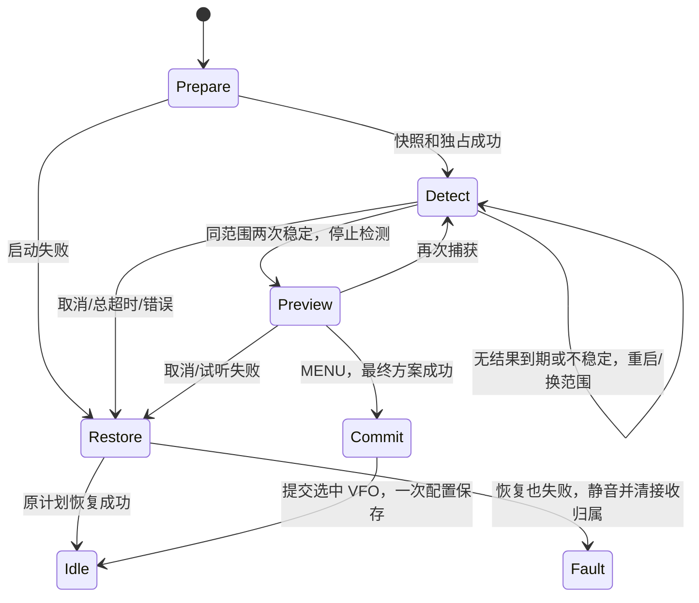

# FC 频率捕获设计

2026-10-13。**设计阶段，尚未启用 FC**。前置资源审计见 [Flash 预算](flash-budget.md)。本机为 DP32G030、60 KiB Flash、16 KiB RAM、512 KiB EEPROM；首批复用当前接收／VFO／频道管理，独立于旧 FC、Loot 和频道扫描代码。

## 首批范围与交互

目标是识别附近正在发射的较强载波，让用户试听后再决定采用或保存。它利用 BK4819 的频率检测寄存器，不是逐步扫描已知频段，也不负责识别发射者、解调模式或亚音。

- 入口规划为 VFO 菜单新增 `Capture` 动作，仅在连续 VFO 来源可启动。当前 **F→4 频道管理保持**；不会在本轮设计中偷偷重绑。面板 4 键虽印 FC，后续统一快捷键时再决定调整。
- 启动后绑定当前选中的 A–D 项，暂停双守听、Seek、普通静噪轮询和 RDS，关闭音频。PTT 不启动 TX，EXIT／MENU 取消；等待时间有界。
- 首批默认 Auto（VHF/UHF 轮换），可用侧键循环 Auto／VHF／UHF，切换立即清候选并重启一轮。滤波分界使用当前整机设置，经 HAL 转换，纯运行时不读取 gSettings。
- 检测中在当前 VFO 组件显示 `FC` 与滤波范围。稳定候选出现后**停止检测**，使用临时 NFM 方案试听，并显示实际捕获频率；不写 VFO、频道或 EEPROM。
- 结果页 `MENU` 将成功调谐的候选提交为当前 VFO，TX Enabled 强制 Off，RX Tone Off；不继承未知电台的发射授权。采用后通过已有 Name／Save 显式保存频道。EXIT 恢复原 VFO；侧键重新捕获前结束试听。
- 不直接覆盖 MR、不批量保存、不做后台记录／Loot、不推测 TX 参数、不加入亚音自动解码、中文或新字库。亚音检测以后作为独立步骤加入。

进入 Capture 时必须显示明确的“临时试听／确认采用”状态；试听期间只有实际接收的选中项可显示信号，不在另一个 VFO 上保留旧 RX。最终采用会改变当前连续 VFO；取消则恢复入口时的工作状态。

## 驱动依据与初始参数

现有 `drivers/bk4819/bk4819.c` 已有 `BK4819_EnableFrequencyScanEx()`、`BK4819_GetFrequencyScanResult()` 和 Disable。读 `0x0D` 的 bit 15，清零表示结果完成；拼接低 11 位和 `0x0E` 得到驱动频率表示。芯片接口按 10 Hz 表示，HAL 对结果做溢出与范围检查，再乘 10 转为 Hz。**表示单位不是测量准确度承诺。** 最终还需要晶振偏差、谐波／强信号误捕和 RF 路径实测。

首批从现有标准路径 `0x0245 | (time << 14)`、`F_SC_T_0_2s` 开始，不沿用旧 FC 的 `hz=0x244/0x580` 可调魔数。REG32 相关字段、检测前置配置与退出顺序应在实施时核对应用说明，并通过实机记录验收；驱动现有写法不能单独证明正确硬件流程。

稳定判定初始为同一滤波范围内**连续两次有效检测相差不超过 3,000 Hz**。换滤波范围或收到无效结果即清累计，不将跨范围结果拼接。采用最新一次有效测量，不按当前 VFO 步进默默取整。

Auto 模式每个有界尝试结束后换范围；连续无结果也换，避免旧代码只有“读到结果”才推进导致一直停在一个范围。暂定轮询 20 ms、单次检测上限 500 ms、会话总上限 15 s；这些是首批工程默认值，待硬件测试调整。超时、取消、失败恢复都不更新用户频率。

范围和试听能力使用 `RADIO_MODEL_Plan()` 验证：NFM、BK4819、整数 10 Hz 栅格、频率不被规划器修正。滤波范围另按板级分界检查。不以原始 27-bit 结果上限推导整机接收范围，也不声称覆盖 HF／SSB。旧 FC 的 88–108 MHz 排除不直接照搬：它是历史策略，不是当前统一模型的能力判断。

## 模块与接口边界

| 层 | 所属文件（规划） | 职责 |
| --- | --- | --- |
| BK 芯片驱动 | `drivers/bk4819/bk4819.c`、`rx.c` | 寄存器、检测启动／停止、原始结果、模式缓存失效；不认识 VFO／频道 |
| 整机适配 | `hal/rx-device.*` | 静音／旧芯片离开、滤波路径、Hz 转换、结束检测与硬件缓存失效 |
| 纯逻辑 | 新 `core/capture.*` | 有界尝试、范围轮换、频率合法性输入、两次稳定判定、取消／超时；无寄存器、全局配置或 EEPROM |
| 应用 | `apps/vfo.c` | 入口快照、排他占用接收资源、临时试听、确认提交、失败恢复与显示 |
| 现有频道模块 | `channel-store.*` | 用户采用后通过原保存流程写频道，捕获运行时不调用它 |

建议的公共 API（尚未实现）：

```c
// core: range 是捕获策略，不暴露 BK 寄存器、GPIO 或 time bit 编码。
CaptureResult CAPTURE_Start(CaptureRuntime *runtime,
                            CaptureScope scope, uint32_t now_ms);
CaptureAction CAPTURE_Update(CaptureRuntime *runtime, uint32_t now_ms,
                              const CaptureSample *sample);
void CAPTURE_Cancel(CaptureRuntime *runtime);

// HAL: 适配器 owns detector；频率统一 Hz，BUSY 与 I/O 失败分开。
bool RX_DEVICE_CaptureStart(CaptureRange range, RxDevice previous);
RxCaptureResult RX_DEVICE_CapturePoll(uint32_t *frequency_hz);
void RX_DEVICE_CaptureStop(void);
```

`CaptureSample` 的 NONE／BUSY／FOUND／ERROR 与频率明确；纯运行时输出 BEGIN_ATTEMPT／STOP_ATTEMPT／CANDIDATE／DONE。应用执行硬件动作，调用结果再作为事件输入；Start 失败不会被当成 BUSY 无限重试。`CaptureRuntime` 保存范围、last_hz、hits、attempt_deadline、session_deadline、phase 等，目标约 32–48 B；RxPlan／VFO 快照由应用持有。

不要为旧 `FC_init/update`、`ExtendedVFOContext`、`gLastActiveLoot`、`gSettings.fcTime` 增加兼容包装。旧应用只作参考，厂商参数留在驱动／HAL。

## 状态机与接收事务



1. **准备**：拒绝 TX／PTT 等待释放、其他输入或未完成事务；先 pauseWatch 恢复选中接收项，冻结 selectedVfo、入口的用户状态和最后成功 RxPlan。准备失败不进入检测。
2. **临时检测**：RxRuntime.current 仍保存原成功计划；检测状态不是普通 RX，不播放旧音频、不读旧 RSSI／RDS、不请求配置保存。其他界面切换要走 Cancel，不能只隐藏 FC 画面。
3. **停止与失效**：所有离开检测的路径都调用 CaptureStop，关闭检测、让 BK 回到可恢复状态、清除 HAL `bkCached` 和驱动 RxMode 缓存，必要时使滤波选择缓存失效。FC 可能改过寄存器，恢复到同频不能走 fastBk。普通 Seek 的 Cancel 不能替代此动作。
4. **跨芯片恢复**：进入前可能接收 SI4732 或 BK1080。HAL 保存/明确管理临时 BK 所有权，停止时先停 BK，再按原 RxPlan 完整恢复正确芯片和音频；不能根据仍指向 SI 的 RadioReceiver 镜像假定“硬件没变”。RDS 在重调谐时 reset，成功恢复后重新开始。
5. **试听**：候选先经统一模型校验，再通过硬件临时调谐；失败停止检测并恢复。更新物理接收归属和显示，但不把临时计划写入用户状态、频段记忆或 MR 缓存。
6. **确认**：只在最终调谐成功后调用 RADIO_VFO_Set，提交捕获频率／NFM／Tone Off／TX Off 到启动时的选中 VFO，清频道编辑目标和旧标签，最多请求一次正常配置保存。保存失败仍沿用现有 dirty／重试机制。
7. **取消／错误**：恢复入口计划后恢复原用户状态和接收归属，守听可按原开关延迟恢复。双失败保持静音、clear receivingVfo，提示可重试。所有 detector stop／audio mute 处理须可重复调用，PTT 释放仍由系统优先处理。

## 资源预算与验收

首批设计预算：驱动／HAL 约 250–450 B、纯运行时约 350–550 B、入口与 UI／事务约 600–800 B，总计 **1,200–1,800 B Flash**；**新增静态 RAM 控制在 128 B 内**。预计值可能因 LTO 变化；实施时逐步链接，不以源代码行数或 unused driver 函数大小相加代替测量。

不增加字体、持久化字段、配置版本或频道区。不创建发现历史数组。必须先达到 Flash 审计中的基础镜像预算，完整 FC 后建议至少留 1 KiB 余量。

主机验收：

- 开始、停止幂等；首次启动失败；长时间 BUSY；两次稳定；频率差边界；换范围清 hits；重复假信号；Auto 无结果也轮换；deadline 回绕。
- 原始频率转换溢出、芯片范围空洞、规划器量化、范围不符；失败不进入试听、不修改配置。
- BK／SI／BK1080 入口取消与恢复；同频恢复仍执行完整配置；停止前不会做普通静噪／RDS／守听操作。
- 临时试听和取消零 EEPROM 写入；MENU 成功只提交启动归属项；其他 VFO／频道记录不变；MR／TX／输入状态拒绝启动。
- PTT 释放、取消、切应用、驱动失败、试听失败、恢复双失败、重新捕获、采用后保存频道；最终镜像和新增 RAM 实测。

实机验收：VHF/UHF 单信号及 Auto、短发射、多强信号、空场、频率偏差和重复稳定性；正常 RX 的同频／跨芯片恢复、声音／静噪／背光／RDS；从所有状态 EXIT 返回。全部仍是接收功能，不开启 PA。
