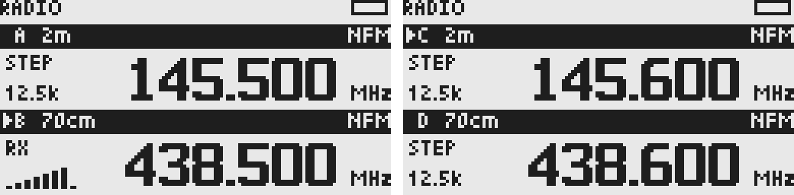
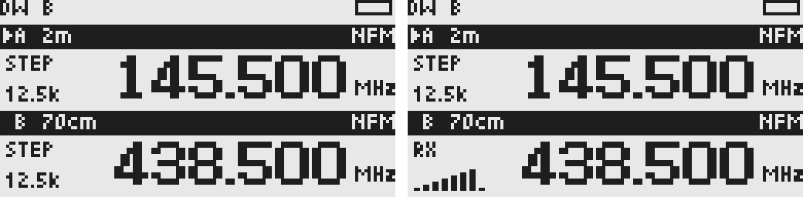

# 多 VFO 与双守听

2026-10-13。当前实现支持保存四个独立 VFO、启用其中 2／3／4 项、每页显示两行，守听参与项与保存数量分开。双守听按实际芯片分流：同芯片的不同频率轮询，不同芯片保持并行接收，仅切换音频出口；单一扬声器不混播两路。并行接收的软件控制已实现，实际音频和射频路径仍待设备验收。频道来源与频道保存见[VFO 保存频道与频道模式](channel-mode-design.md)。配置格式 8 在格式 7 的 VFO 状态上增加每项的 VFO／频道来源和频道编号。

## 状态和操作

- `RADIO_VFO_CAPACITY` 为保存容量，当前 4；`radio.vfo_count` 为已启用数量，默认 2；`RADIO_VFO_VISIBLE` 为可见行数，固定 2；`RADIO_WATCH_LIMIT` 为首批守听参与上限，当前 2。四个预算互不替代，不用屏幕行数限制用户状态。
- `Settings → Receive → VFO count` 在 2／3／4 项之间调整。`F → 2` 按已启用数量循环，四项为 A→B→C→D→A。目标方案不可用或调谐失败时保留原选择，不静默修改目标模式。
- 选中 A/B 时显示 A/B，选中 C/D 时显示 C/D；仅启用三项且选中 C 时显示 B/C，保持选中项可见，不绘制第三行。
- A/B/C/D 各自拥有当前 RX/TX 参数、各频段记忆和已确认 RDS 缓存；频段预设共享。新增 C 初始为 2m、D 为 70cm，使用内置初始频率和共享预设。
- 减少启用数量保留隐藏项的频率与参数，移除隐藏项的守听资格。隐藏了当前选中项时选择回到 A，返回主界面后应用 A。重新增加数量可继续使用原 C/D 参数。
- `Settings → Receive → Dual watch` 是总开关，默认 Off。各 VFO 菜单的 `RX Watch` 决定是否参与；默认 A/B 为 On，C/D 为 Off。最多两个 On，第三项请求显示 `Watch limit: 2` 且不改配置。要更换参与项，先关闭一项，再打开目标项。
- 保存项／选中项／实际接收归属分别处理。守听可以接收 B 而箭头仍在 A；调频、菜单、搜索、输入和 PTT 始终属于选中项。选中项不必加入守听组。

布局预览：左侧 A/B，右侧 C/D。



双守听预览：左侧探测 B，右侧 B 命中；操作箭头始终留在 A。



## 按芯片调度

`WATCH_Start()` 根据两个有效接收方案的 `device` 自动选择策略，不按频段名称分类，不额外增加用户设置。

| 接收方案组合 | 策略 |
| --- | --- |
| BK4819 与 SI4732（例如 438.500 NFM＋95.9 WFM） | 各自配置一次并保持接收，独立读取信号／静噪，按优先权切换音频 |
| BK4819 与 BK1080 | 同样保持两颗芯片接收，只切换音频 |
| 同芯片、不同频率（例如两个 BK4819 NFM） | 保留稳定等待、二次确认与有界轮询 |
| 同芯片、相同有效接收方案 | 合并为一个目标，不能算作两路守听 |

### 不同芯片并行接收

`WatchRuntime` 保存两份接收方案，以及独立的准备、稳定、信号候选、二次确认和失败冷却状态。每次 update 最多配置一颗芯片；准备完成后持续检测，两路确认的有效信号同时保留。准备或读取失败时只对失败芯片有界重试，不重新配置正常的另一颗芯片。

`RX_DEVICE_ApplyConcurrent()` 配置目标芯片并保持其输出静音，不调用另一芯片的 Idle／PowerDown。`RX_DEVICE_SelectAudio()` 先关闭扬声器并静音参与芯片，再打开唯一音频来源；BK 只切 AF／DAC，接收 DSP 保持工作，SI 只切音量，不断电或重新加载模式。音频路径切换失败时扬声器保持关闭，不能混播或使用旧路径冒充新路径。

播放归属变化时，`RADIO_SelectPreparedRxPlan()` 更新显示／测量镜像和前台 `RxRuntime`，不执行调谐。芯片接收计划由守听状态保持，前台运行时仅表示当前播放／恢复对象。普通静噪轮询不能越过守听的音频仲裁；守听自己采样并更新当前播放项的测量。

SI WFM 的 RDS 不依赖当前扬声器是否播放 SI：BK 通话期间继续从 SI 读取并更新该 SI 目标的标签缓存。音频切换不重置 RDS；改变 SI 频率、停止守听或接收恢复时按现有规则清理解析状态。

### 同芯片轮询


`core/watch.*` 是不调用硬件的有界状态机；应用通过调谐、信号检测、音频与时钟回调连接前台 RxRuntime／RadioState。同芯片分支只保留一个实际活动频率。驱动同步调用返回后才开始稳定计时。每次 update 最多应用一个 RF 方案，不循环等待硬件。

```text
调谐 → 等待稳定 → 首次检测 → 再次确认 → 驻留播放
                       ↓ 无信号             ↓ 信号消失
                    下一项              静音等待恢复
                                           ↓ 超时
                                         下一项
```

首批使用可调整的保守时序，尚不是实机测出的最佳值：

| 项目 | 当前值 |
| --- | ---: |
| BK 调谐后稳定等待 | 180 ms |
| SI／BK1080 稳定等待 | 350 ms |
| 信号二次确认间隔 | 80 ms |
| 驻留期间检测间隔 | 50 ms |
| 信号消失后的恢复等待 | 1 s，期间静音 |
| 同芯片后台项连续驻留上限 | 3 s，然后检查选中项；选中项有效接收不强制轮换 |
| 失败项冷却／全组重试 | 2 s |
| 手动操作后暂停 | 2 s |

无信号时，一轮理论软件稳定等待约为两项等待时间之和，另加芯片配置、总线、主循环调用等时间。真实轮询周期不能仅用上述常量相加宣称；需要在设备上测量切换、稳定与亚音判定时延。只有同芯片后台项达到驻留上限时，才短暂中断其音频以检查选中项；选中项保持有效信号时不因 3 秒超时切走。不同芯片不使用驻留超时探测，后台芯片一直保持接收。

参与项先通过 RX 方案解析；不可用方案被过滤，不能悄悄换模式。相同芯片、频率、模式、带宽、静噪和 RX Tone 的项合并为同一路径，步进不同不构成两个接收目标。若剩余不足两个独立目标，保持选中项接收，每 2 s 再评估，选中 VFO 的频率／名称区域说明 `DW: select 2`、`DW: same channel` 或 `DW: unavailable`，标题栏保留接收归属。

首批支持 BK NFM／AM、SI WFM／AM、BK1080 WFM 的轮询；SSB 不加入守听组，显示 `DW: SSB off`，仍支持手动选择和接收。SSB 模式／补丁切换耗时未测量，不以未经验证的快速切换周期开放其轮询。若计划探测／调谐全部失败，退回主接收并有界重试；主接收恢复失败则静音，不能在每次 update 重复恢复。

## 信号、音频与归属

`RX_DEVICE_WatchSignal` 独立检测信号，不能把 SQ0 或 Monitor 的常开音频当成命中：BK 使用至少 SQL4 对应的 RSSI／Noise／Glitch 门槛，有非零 SQL 时再检查硬件静噪，RX Tone 必须匹配；SI 和 BK1080 使用独立 RSSI／SNR 门槛。检测只读取状态，不改写用户静噪或亚音。门槛仍需信号源实测。

探测、稳定和二次确认期间保持音频关闭，并暂停系统普通静噪更新；命中后才允许该接收归属的测量／音频更新。另一行不能借用当前芯片 RSSI。等待时左侧显示 DW，命中音频打开时显示 RX 和阶梯信号。

状态栏 `DW A/B/C/D` 表示当前前台接收／播放归属，包括不在当前页的守听项；箭头表示操作／PTT 归属，守听不改变页或选中索引。RDS 从 SI WFM 接收项读取，并行分支在 SI 静音时也继续更新该 VFO／频率对应缓存，不能因为选中 A 就把 B 的 RDS 写给 A。

## 选中项决定音频优先权（已实现）

双守听的策略为：**选中 VFO 拥有音频优先权，非选中守听项不能抢占选中项的有效接收音频。** 选中箭头表示用户希望优先收听和操作的对象，RX 标记表示实际正在播放的对象，两者可以不同。优先权随用户切换选中项变化，不新增独立优先级设置，也不按广播／对讲频段或 WFM／NFM 模式硬编码例外。

以下以 A、B 都参与守听为例，A 为 95.9 MHz WFM 广播、B 为 438.500 MHz NFM：

| 当前选中项 | 信号状态 | 音频行为 |
| --- | --- | --- |
| A | A 持续有效，B 空闲或收到信号 | 继续播放 A，B 不插入音频 |
| A | A 无有效信号，B 有效 | 可以播放 B；A 恢复有效信号后优先播放 A |
| B | B 无有效信号，A 有效 | 可以播放 A，选中箭头仍在 B |
| B | B 收到有效信号，A 仍有效 | B 抢占音频，静音 A，播放 B |
| B | B 信号结束，A 仍有效 | 保留短暂恢复等待；B 未恢复时返回 A，选中箭头仍在 B |
| 任一项 | 两项均无有效信号 | 保持静音并继续检测 |

如果 A 改为 439.325 MHz NFM 正在通话，规则完全相同：选中 A 时 B 不打断 A；选中 B 时 B 可以打断后台播放的 A。用户切换选中项代表主动改变收听优先权；若新选中项暂无信号，可继续播放另一有效守听项。

“有效信号”沿用静噪、信号质量与 RX Tone 匹配条件，不是语音内容识别。信号结束后保留短暂等待，避免通话间隙频繁切回；当前等待 1 秒，期间静音，优先项信号恢复则继续播放它，具体时序需实机验收。播放选中项期间，不再因固定 3 秒驻留上限强制切走；播放非选中项期间，不同芯片持续检测选中项；同芯片周期性调谐检查，以保证其优先权。

双守听关闭时只接收选中项，不使用另一项填补静音。双守听开启时仍受 RX Watch 参与资格和首批两项上限约束；优先权不自动把未参与的选中项加入守听组。

音频自动切换只改变实际接收／播放归属，不改变选中索引、可见页、用户频率、频道来源或 TX 参数，不触发 EEPROM 保存。PTT 始终属于选中项，先恢复并校验其接收／发射方案；不能因为后台项正在播放就把发射目标转过去。测量与 RDS 缓存继续归属实际接收项，不能把后台信号标成选中项的 RX。

### 实施与硬件边界

- 不同芯片的并行接收／互斥音频路径已经接入；本轮没有刷机，没有实测本机天线／音频电路、后台亚音匹配或噪声。寄存器命令成功不能替代实际音频验收。
- 同芯片两个频率仍需要时分轮询；播放后台项时检查选中项存在音频间隙和短呼叫漏检，周期需实测。播放选中项时保护其音频，不探测另一个频率。
- 本轮实现选中项抢占后台项、后台项不能抢占选中项、1 秒信号结束等待、手动切换优先权、PTT 归属及自动切换不保存，见对应回归测试。

## 抢占、PTT 与持久化边界

任何调频、模式／频段操作、菜单、确认、搜索、输入或离开主应用都会暂停调度并恢复选中项。并行分支先静音并停止参与芯片，再完整恢复选中项，不能遗留后台音频；重新恢复守听后再配置两颗芯片。恢复失败则明确提示和静音，不允许把恢复到的后台方案当作主方案继续发射。PTT 在方案校验之前恢复选中项，生命周期内停止守听；释放后恢复该主 RX 方案，再允许恢复调度。键盘锁仍保留 PTT release 优先处理。

守听的临时调谐只改变 RF 运行时，不更新用户频率、各频段记忆、选中索引，不请求 EEPROM 保存，不重置用户的频率／名称显示计时。用户修改 Watch、Count、总开关才请求配置保存。

## 配置格式 7 与 8

格式 7 保存容量增至四项，每 VFO 磁盘字段为 170 B（此前 169 B 加 Watch 1 B）；头部 16 B、Count／Selected／总开关 3 B、共享预设 90 B、全局设置 21 B。格式 7 固定记录内容共 **810 B**。格式 8 每个 VFO 再加入 1 B 来源和 1 B 频道编号，记录内容共 **818 B**；两者都放入 1024 B 槽，CRC 覆盖整槽。格式 7 只迁移 VFO 与全局设置，新增来源默认为 VFO，不迁移旧频道记录。

| 地址 | 用途 | 普通固件写权限 |
| --- | --- | --- |
| `0x0000–0x03FF` | 格式 4／5／6 的旧双 512 B 槽 | 只读迁移，升级后仍保留 |
| `0x0800–0x0BFF` | 格式 7/8 槽 0 | 配置写入 |
| `0x0C00–0x0FFF` | 格式 7/8 槽 1 | 配置写入 |
| `0xB000–0xDFFF` | 128 个用户频道，每项双 48 B 副本 | 频道专用写入 |
| `0x1E00–0x1FFF` | 原厂校准 | 只读 |
| EEPROM 尾部预留 | SI SSB patch | 只读 |

加载优先选择有效新槽；新槽均无效时读取旧双槽并在内存迁移。格式 4／5 的原状态进入 A，B/C/D 按共享预设初始化；格式 6 完整保留 A/B 和选择，初始化 C/D；格式 7 保留四项 VFO／Watch 状态，新增字段采用 VFO 来源。迁移后默认启用两项、总开关 Off、A/B 参与，避免升级即开始自动调谐。

首次保存写入新槽并在旧序号基础上递增，不覆盖任一旧槽；中断仍可从旧记录恢复。此后新双槽轮换、CRC 与回读校验。用户频道使用独立双副本和 CRC，不与配置槽共写；旧频道区内容不迁移也不解释。只扩展明确写入区域，不擦除整片，不碰校准和补丁。旧固件不会读取新配置，降级可能恢复升级前的旧状态，不承诺同步。

API 显式接收输入记录长度，以 512 B 解码旧格式、1024 B 解码新格式，拒绝长度不符。容量预算基于固定官方绿色 UV-K6、512 KiB EEPROM；并不把 MCU RAM 当作 512 KiB。CONFIG_Load/Save 顺序复用单个候选，避免随着容量增加保留三份完整配置在栈上。

## 验证与后续

- `tests/parallel-watch-regression.c`：不同芯片只准备一次、持续双路检测、仅切音频、选中优先、静音挂起、读取／准备失败独立重试、时间回绕。
- `tests/watch-regression.c`：调谐后计时、双确认、驻留／挂起／恢复、选中项连续接收及后台有界检查、重复项、空组、SSB 排除、读／调谐失败冷却与时间回绕。
- `tests/vfo-regression.c`：四项循环、三项页、隐藏项保留、参与上限、后台 RX／RDS 归属、临时调谐无保存、手动／菜单／PTT 抢占、失败恢复不忙循环。
- `tests/rx-device-regression.c`：SQ0 噪声门槛、Noise／Glitch、亚音匹配、SI SNR 与读失败。
- `tests/config-store-regression.c`：格式 4／5／6 迁移、旧槽保留与首写中断、四项 RX/TX／Watch 保存、非法值、坏槽及容量保护。

本轮并行守听通过 `sh tests/run.sh` 和 `make -j4`；Flash 59,648 / 61,440 B，链接 RAM 8,088 / 16,384 B，未刷机。此前多 VFO 与双守听版本通过 `sh tests/run.sh` 和 `make -j4`。加入频道模型后的 ARM `make -j4` 构建通过：Flash 59,404 / 61,440 B，静态 RAM 7,920 / 16,384 B。频道模式及 EEPROM 实机写入尚未刷机验收；静态构建结果不替代掉电恢复、接收和频道切换实测。

后续先在设备上验收不同芯片音频互斥、持续接收和 RDS 归属，再测量同芯片稳定时间和短呼叫漏检；守听参与上限、SSB 和更多音频保护另行评估。保存容量、显示行数、守听数量继续分开配置，不因扩展到四个保存项就自动轮询四路。
