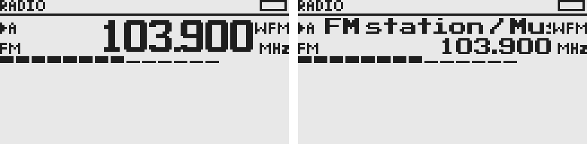
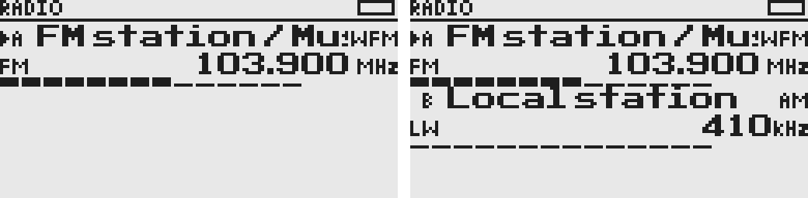
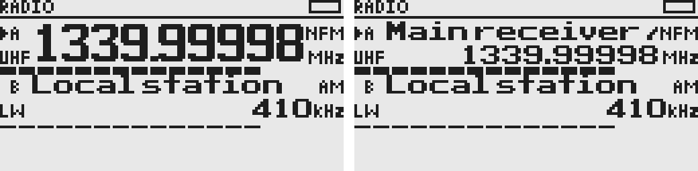

# 紧凑 VFO 布局

2026-10-12：128×64 屏幕，公共状态栏保留顶部 8 像素。`ui/components/vfo.c` 的单个组件固定为 128×20，可分别放在 y=8 与 y=28；当前固件只渲染第一份。

| 组件内部位置 | 元素 |
| --- | --- |
| 左侧，基线 y+6 / y+15 | 选中箭头、VFO 标识与修改标记 / 频段缩写 |
| 中间，无名称／RDS | 14 像素高频率，基线 y+14，右对齐 |
| 中间，有名称／RDS | 名称在上（基线 y+6），频率在下（基线 y+15），使用相同的 7 像素高粗体字体；名称超长滚动，频率右对齐 |
| 右侧，基线 y+6 / y+15 | 模式 / 单位 |
| y+17～y+19 | 3 像素高的信号条及接收状态 |

名称与频率共用中间区域，没有为名称预留独立顶行。无名称／RDS 时，大字号频率占用整个区域；有内容时改为同字号的名称和频率上下排列，组件高度保持不变。

名称栏：只有名称或 RDS 时直接显示；都有时以 ` / ` 拼接，仅超出可用宽度时滚动。首尾短暂停留，内容改变时重置滚动。频段缩写和频率不滚动。当前字体为 ASCII，尚未加入中文字库。

组件通过 `UI_VfoView` 接收数据，各 VFO 使用独立 `UI_VfoState` 保存滚动状态，不访问接收器全局状态。无有效信号时显示空条。名称、RDS 数据入口已预留，当前应用尚无名称编辑和 RDS 文本解码接入；示例不表示已经具备双守听或 RDS 解码。

下图直接使用固件绘图代码渲染帧缓冲，再放大四倍。左为单 VFO，右为两个组件；电台名称及信号强度均为示例数据。

在仓库根目录运行 `python3 tools/ui-preview.py` 可重新生成上图。预览工具及自定义输出、缩放说明见 [开发工具](../tools/README.md#ui-预览)，示例数据在 `tools/ui-preview.c` 中。

组件按职责放在 `src/ui/components/`：`vfo`、`signal`、`battery`、`frequency`、`scan`，各自使用独立头文件。帧缓冲布局、滚动裁剪和组件隔离由 `tests/vfo-component-regression.c` 检查。

频率由 `ui/components/frequency.c` 的 `UI_FormatFrequency` 统一格式化：低于 1 MHz 用 kHz，否则用 MHz。MHz 至少保留三位小数，额外小数仅用于精确表示实际频率；kHz 省略无意义的末尾零。主界面与量化确认共用格式化函数。

频段缩写为 `LW / MW / SW / FM / AIR / 2m / 70c / VHF / UHF`，左下列占 x=0～10。名称／RDS 只在中间区域显示，与两侧固定栏隔开。预设修改标记 `*` 放在 VFO 标识后。

模式、单位右对齐，频率在二者最大宽度前留一像素间隔。无名称时保持 14 像素高数字字形，只取消小数点后的一个空隙像素：最长 `1339.99998` 宽度从 102 减到 101 像素。NFM/MHz 下频率占 x=12～112，左右均有一像素间隔，频段列与模式列不重叠。步进暂不显示，信号条及状态提示行保留原用途。

用 `python3 tools/ui-preview.py --frames max maxtext --output /tmp/vfo-max.png` 可对比最长频率有无名称；`--frames` 的两个参数还可选择 `single`（有名称）、`plain`（无名称）、`dual` 和 `lw`。
