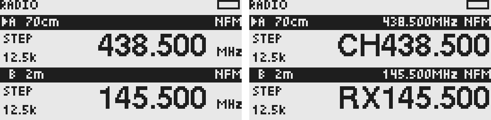

# VFO 首屏布局

2026-10-13：128×64 屏幕，顶部公共状态栏占 8 px。每个 VFO 组件为 128×28，可分别放在 y=8 和 y=36，刚好容纳两个组件。当前最多启用四项，每页两行，F→2 循环并分页；默认单项接收，可开启独立两项轮询守听。公共状态栏保留标题和状态图标；错误与操作提示在对应 VFO 的频率／名称区域显示，复用名称／RDS 的字号和单行滚动，不覆盖另一 VFO。

## 高度与宽度

| 屏幕区域 | 高度 | 内容 |
| --- | --- | --- |
| 公共状态栏 y=0～7 | 8 px | 左上角 RADIO 标题；电池、锁定、F 前缀等公共状态 |
| 每个组件顶部 | 8 px | 黑底横条：选中箭头、A/B、预设修改标记 `*`、完整频段名称、右对齐模式 |
| 横条与正文间隔 | 1 px | 分隔 |
| 正文 | 17 px | 左侧活动信息；右侧频率或名称 |
| 组件尾部间隔 | 2 px | 分隔两个 VFO |

正文左侧使用 x=0～27，x=28～29 留作间隔，频率／名称使用 x=30～127。大字号频率右边缘固定在 x=110，单位右对齐到屏幕边缘。主频率、名称和提示统一使用原生 12 px ASCII 粗体，字母、数字和标点来自同一字库，按原生字间距绘制。

MHz 的前三位小数与整数部分用大字显示，实际需要的第四、第五位（格式化器也支持第六位）用小字堆叠在 MHz 上方，不舍入已应用频率。没有额外小数时该位置空白。最长主数字 `1339.999` 的字符步进宽度为 68 px，左侧可保留 42 px；`438.506` 为 59 px，左侧可保留 51 px。低于 1 MHz 使用 kHz，保留实际需要的小数，例如 `410`、`410.02`，末尾零省略。

## 频率与名称状态

默认显示大字号频率。最后一次成功调谐后保持频率 1 秒，有名称／RDS 时切换为名称；没有文本时保持频率。名称状态下，完整频率与单位移到黑底横条，在频段和右侧模式之间显示。再次调谐立即回到大字号频率，同频率重新调谐也重新计时。搜索期间保持频率，搜索结束后再保持 1 秒。RDS 较晚到达时，若调谐保持时间已过，直接显示文本。

名称与 RDS 共用区域：只有一项直接显示，两项以 ` / ` 拼接；超宽时滚动，首尾各停留 1.2 秒，每 150 ms 移动 1 px。完整频段名称也在横条独立裁剪、超宽滚动，模式与频率保持固定。

正文预留 17 px，足以容纳后续 12×12 中文字形。**频率、名称／RDS 和错误提示共用 Adobe X11 Helvetica Bold 原生 ASCII 点阵：大写字母与数字均高 12 px，含小写下伸和标点的完整字符范围占 17 px。相同数字在名称与频率中使用完全相同的字形、宽度和基线，不使用两倍缩放。字体来源、许可和生成方式见 [字库说明](../src/ui/fonts/README.md)。尚未实现中文解码和字库读取。** 当前应用已经接入 SI4732 WFM 的 PS 与 RadioText，详见 [RDS 接收与解析](rds.md)；自定义 VFO 名称编辑尚未实现。


相同数字的统一字形示例（右图名称为演示文本）：



左图为频率状态，右图为名称状态；均使用当前固件绘图代码和示例数据。

## 活动信息

| 状态 | 左侧正文 |
| --- | --- |
| 空闲／静噪关闭音频 | `STEP` 与紧凑步进，如 `12.5k` |
| 实际接收、音频打开 | `RX` 与八列阶梯信号图标；测量无效时显示 `--` |
| 发射 | `TX` 与 `LOW / MID / HIGH` 档位 |
| 搜索 | `SEEK` 与箭头 |
| 无可用接收路径 | `RX` 与 `--` |
| 硬件失败 | `FAULT` 与 `RX` |

取消横向 S 条，阶梯图标使用已有 0～14 相对信号映射，不把 SI 的相对强度标成未经校准的 S 值。当前真实发射仍禁用，TX 布局只为后续状态保留；档位不代表实测瓦数。


## 实现与验证

`src/ui/components/vfo.c` 接收 `UI_VfoView`，每个 VFO 独立持有 `UI_VfoState`，不访问接收器全局状态。活动状态显式传入，不以 RSSI 有效推断静噪已打开。频率统一由 `UI_FormatFrequency` 格式化。

`tests/vfo-component-regression.c` 验证显示切换、同频率重新调谐、迟到 RDS、搜索结束计时、滚动裁剪、最长频率边界、双组件隔离及计时回绕。预览使用固件真实帧缓冲与字体，不模拟字形。

```sh
python3 tools/ui-preview.py --frames frequency name --output docs/images/vfo-states.png
python3 tools/ui-preview.py --frames max lw --output docs/images/vfo-limits.png
```

更多场景见 [开发工具](../tools/README.md#ui-预览)。

A/B 的 `UI_VfoState` 独立保存频率停留和滚动；只有实际接收且确认信号的项显示有效信号和 RX，探测期间显示 DW。其他项保留自己的频率／文本及步进，不借用活动接收器的 RSSI。RDS 文本缓存按 VFO、频率归属，重新调谐清空当前缓存；活动路径无新数据 15 秒后清空文本。

四项时页面为 A/B、C/D；三项且选中 C 时页面为 B/C。后台接收不改变选中箭头或翻页，公共状态栏 DW 标记报告物理接收归属，包括不在当前页的项。

四项分页和双守听的当前预览见 [多 VFO 与双守听](multi-vfo-design.md)，预览通过同一组件生成，字号未改动。
