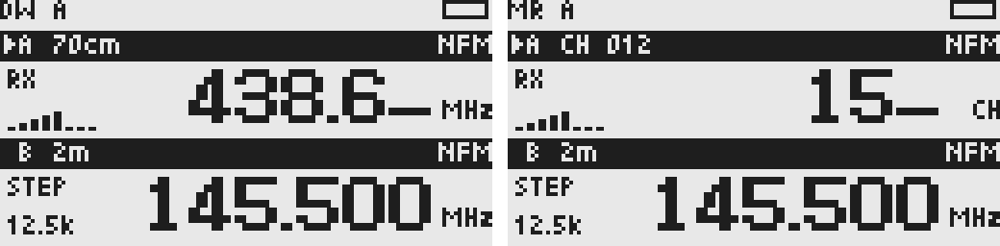
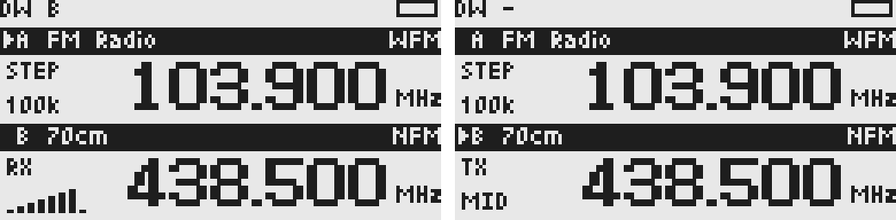

# 用户手册

更新于 2026-10-14，按当前代码核对。本文描述当前操作；功能取舍见[设计文档](design.md)，编译和工具见[开发文档](development.md)，设备基线与存储保护见[硬件事实](hardware.md)。代码已实现不等于实机性能已验收。

## 1. 功能与首次使用

主屏幕支持 A/B/C/D 四个独立 Slot，可启用 1–4 个，每页显示两个。每个 Slot 可以直接调频（VFO）或读取已保存频道（MR）；切换来源不会丢掉原来的 VFO 频率和频段记忆。两个及以上 Slot 自动守听，没有额外的 Dual watch 或 RX Watch 开关。只听一路时将 Slot count 设为 1。

接收模式为 NFM、WFM、AM、LSB、USB。芯片由频率、模式和硬件能力共同决定，不需手动选择，没有 Auto 解调模式。默认固件包含 BK4819 NFM 发射和 FC 频率捕获，各 Slot 的 TX Enable 初始均为 Off。中文显示、NOAA、VOX 和呼叫频道快捷键尚未实现。

### 刷入与初始化

1. 编程线连接电脑和设备，关闭电源，按住 PTT 开机进入 Bootloader。
2. 使用[刷机命令](development.md#2-刷机与恢复)写入固件。刷机不会自动初始化 EEPROM。
3. 有有效 UVR2 格式 9 配置时恢复已保存状态；没有有效配置时显示 No UVR2 config，写入保持锁定。
4. 初始化前备份原 EEPROM。按 0 进入 Initialize UVR2?，再按 1 确认；EXIT 取消。初始化只写配置双槽，成功后重启。

旧固件和旧版 UVR2 配置不读取、不迁移。初始化不会清空已保存的当前格式频道；未知配置区可能含旧固件数据，确认初始化会覆盖该区域。开机检测到 EXIT 也会进入初始化页面。Cannot initialize 或 Write/verify failed 表示初始化未成功，不能绕过进入正常接收。

### 快速开始

- 输入 `438*500`，按 MENU，调到 438.500 MHz；* 是小数点。
- 侧键 1 或 F→1 切频段，侧键 2 或 F→0 切模式。
- ▲／▼按步进调频，按住连续调节。
- 短按 MENU 打开当前 Slot 参数，长按 MENU 打开全局设置。
- 修改成功后通常延迟约 1.5 秒保存，连续修改顺延。关机前留出保存时间；About → Save status 可查看或立即保存。

## 2. 主屏幕与按键

### 主屏幕截图与区域说明

左图显示两路频率；右图 A 显示广播 RDS 电台名 RADIO FM，B 显示频道 CH 012 的名称 Local。截图由当前固件绘图代码生成，按 4 倍放大；频率、名称、信号和电池是示例数据，不是实机照片或射频测量。

| 位置／标识 | 功能与操作 |
| --- | --- |
| 顶部公共状态栏 | 标题显示主屏幕状态；DW A 表示当前音频属于 A。右侧电池按设置显示图标、百分比或电压；左图的 F 表示正在等待副标快捷键 |
| 黑条左侧箭头与 A／B | 箭头指定调谐、菜单和输入对象；F→2 切换。箭头和正在出声的 Slot 可以不同 |
| B 后面的 *（左图） | RX 参数与频段预设不同，**不表示尚未保存**；可用 Reset to defaults 恢复预设 |
| FM Radio／70cm／CH 012 | 频段名称或 MR 频道编号；F→1 切频段，F→3 切 VFO／MR |
| WFM／NFM | 明确解调模式，F→0 切换当前可用模式；有名称时移到正文右下角 |
| 大号频率与右侧尾数 | 左图 B 为 438.506＋小字 25，合起来是 **438.50625 MHz**，显示未舍入；低于 1 MHz 使用 kHz |
| 大号名称（右图） | 广播 PS 或保存的频道名；完整频率移到黑条右侧。RadioText 更新后可临时占用横条 10 秒，随后恢复 |
| 正文左侧 RX 与阶梯图标 | 实际接收音频打开及相对信号强度，不是校准 S 值；后台轮询不反复闪动 RX |
| STEP／12.5k | 未播放音频时显示调谐步进；在 Slot 菜单的 RX Step 修改，▲／▼按该步进调频 |

频率和名称使用相同的大字；超出正文的尾部改用右侧小字，再超出屏幕则裁剪，不滚动。临时错误和操作提示显示在对应卡片的黑条里，正文保持显示。

### 主屏幕按键

| 按键 | 正常主屏幕操作 |
| --- | --- |
| ▲／▼ | VFO 调频；MR 循环选择有效频道 |
| 数字 0–9 | VFO 输入 MHz 频率；MR 输入频道号（单位 CH），MENU 跳转，空号提示 Channel unavailable |
| MENU 短按／长按 | 当前 Slot 参数菜单／全局设置 |
| 侧键 1／侧键 2 | 切频段／切模式；MR 下不可用 |
| F 短按 | 等待一个副标快捷键，状态栏右侧显示 F |
| F 长按 | 锁定／解锁键盘 |
| EXIT 短按 | 正常主屏幕无动作；在输入、菜单或功能中取消／返回 |
| PTT | 按住申请发射，松开恢复接收；守听时可回复正在接收的频道 |

### F 前缀快捷键

顺序短按 F 再短按目标键，不必同时按住。执行一次即退出；再次 F、EXIT 或等待 3 秒可取消。菜单中的 F 使用菜单本地语义。

| 快捷键 | 功能 |
| --- | --- |
| F→1（Band） | 下一个快捷频段 |
| F→2（A/B） | 在已启用 Slot 间循环 |
| F→3（VFO/MR） | 切换当前 Slot 的 VFO／频道来源 |
| F→4（FC） | 捕获附近强载波频率 |
| F→5（Spectrum） | 打开频谱，与 Slot 菜单 → Spectrum 相同 |
| F→6（H/M/L） | VFO 功率 Low→Medium→High→Low，保存并提示 |
| F→8（R） | 倒频：接收换到发射频率，频差方向随之反转（+↔-，Split 互换两个频率）；再按一次换回。仅 VFO，TX Shift 为 Off 时提示 |
| F→0（FM） | 循环当前频率可用的明确解调模式 |
| F→*（Scan） | 当前频段向前搜台 Seek |
| 其余目标键 | Not supported |

锁键同时锁住两个侧键。默认 PTT 不受锁键影响；Lock PTT too 为 On 时一并锁住。PTT 松开优先处理，不会被锁键吞掉。输入、搜台、捕获和发射期间，各自界面独占按键，普通调谐快捷键不执行。

## 3. 频段、模式与频率输入

快捷频段按 LW→MW→SW→FM Radio→Airband→2m→70cm 循环。VHF、UHF 是匹配兜底，不加入快捷循环。重叠时更窄的频段优先。

| 频段 | 匹配范围 | 初始频率 | 模式 | 步进 | 带宽 | SQ |
| --- | --- | --- | --- | --- | --- | --- |
| LW | 150 ≤ f < 530 kHz | 225 kHz | AM | 1 kHz | 6 kHz | 0 |
| MW | 530 ≤ f < 1800 kHz | 999 kHz | AM | 9 kHz | 6 kHz | 0 |
| SW | 1.8 ≤ f ≤ 30 MHz | 7.1 MHz | AM | 5 kHz | 6 kHz | 0 |
| FM Radio | 64 ≤ f ≤ 108 MHz | 95.9 MHz | WFM | 100 kHz | Fixed | 0 |
| Airband | 118 ≤ f < 137 MHz | 125 MHz | AM | 8.33 kHz | 6 kHz | 0 |
| 2m | 144 ≤ f < 148 MHz | 145.5 MHz | NFM | 12.5 kHz | 12 kHz | 4 |
| 70cm | 430 ≤ f < 440 MHz | 438.5 MHz | NFM | 12.5 kHz | 12 kHz | 4 |
| VHF | 30 ≤ f < 300 MHz 兜底 | 151 MHz | NFM | 25 kHz | 12 kHz | 4 |
| UHF | 300 ≤ f ≤ 1340 MHz 兜底 | 445 MHz | NFM | 25 kHz | 12 kHz | 4 |

表中是固件匹配范围，不保证整机全范围接收。各 Slot 保存独立频段记忆，共享预设。快捷切频段恢复上次频率并应用预设；同频段调频保留当前参数，跨频段采用目标预设。切 Slot 或开机恢复完整参数，不强制重新套预设。

模式按 NFM→WFM→AM→LSB→USB 循环，跳过不可用组合。切模式本身不需确认；必要时调整步进和带宽，只有实际频率量化改变才确认。

| 模式 | 软件接收路径 |
| --- | --- |
| NFM | BK4819：18–660 MHz、840–1300 MHz |
| WFM | 64–108 MHz；优先 SI4732，否则探测到的 BK1080 |
| AM | ≤30 MHz 且有 SI4732 时优先 SI；其余 BK 支持范围用 BK AM 实现 |
| LSB／USB | ≤30 MHz 的 SI4732；须安装全量 CRC 校验通过的 EEPROM 补丁 |

输入允许 150 kHz–1340 MHz，仍须通过模式和能力校验。芯片标称范围与整机效果见[硬件事实](hardware.md#4-接收芯片与能力边界)。

### 频率输入

在选中卡片原地输入，始终以 **MHz** 为单位；草稿不调谐、不保存、不打断守听。0–9 输入数字，* 输入小数点，MENU 确认；短按 EXIT 删除一位，长按 EXIT 取消，内容为空时 EXIT 也取消。

左图正在输入 **438.6 MHz**，下划线是光标；按 MENU 才调谐。右图在 MR 输入 **频道 15**，单位是 CH，黑条仍显示正在接收的 CH 012；按 MENU 成功加载后才换频道，空号不改变原接收。另一张 Slot 卡片保留显示。输入期间 RX 图标可以继续出现，代表原方案仍在接收，不代表草稿已应用。

`0*401` 是 401 kHz，`95*925` 是 95.925 MHz，`438*500` 是 438.500 MHz。非法值保留草稿并显示 Invalid value。不能精确表示目标时，Apply 页展示实际频率，MENU 应用、EXIT 取消。无接收路径或调谐失败时提示原因，不保存失败目标。

## 4. Slot 参数与频段预设

Slot 菜单 ▲／▼选择，* 或 MENU 增加／执行，F（键帽副标 #）减少，EXIT 返回。RX Mode 同样按方向循环。参数成功修改后立即生效，退出不撤销；MR 参数只读，需切回 VFO 修改。

| 顺序／项目 | 含义 |
| --- | --- |
| RX Mode、RX Step、RX Bandwidth | 模式、步进、带宽，只提供可用组合；WFM 为 Fixed |
| RX Squelch | 0–10 |
| RX Tone | Off、50 个 CTCSS、104 个 DCS 正／反码；仅 NFM 可编辑 |
| TX Enable | 当前 Slot 发射意图，默认 Off |
| TX Power | Low／Medium／High，按对应校准档执行 |
| TX Shift | Off 同频、+／- 中继频差、Split 独立发射频率 |
| TX Offset／TX Freq | +／- 时编辑频差，Split 时编辑发射频率；Off 时 --、不可编辑 |
| TX Tone | 独立发射 CTCSS／DCS，Off 关闭 |
| Spectrum | 打开频谱（见第 7 章），`ENABLE_SPECTRUM=0` 时没有此项 |
| Reset to defaults | 恢复当前频段 RX 预设，频率和 TX 设置不变 |
| Save as channel | 选择编号、确认覆盖、输入名称并保存 |

RX Tone 与静噪条件同时满足才开音频，SQ0 也不绕过亚音。CTCSS 如 67.0 Hz，DCS 如 D023N／D023I；没有自动亚音扫描。

TX Offset／TX Freq 在当前行以 MHz 编辑，首个数字替换草稿。0 清除值；Split 未设置时跟随 RX。频差上限 100 MHz，Split 要求 BK 支持范围和 10 Hz 栅格；PTT 另按实际 TX Hz 校验板级范围。修改 TX 不重调 RX、不自动开启 TX Enable。

### 频段预设编辑器

Settings → Band presets 中 ▲／▼选择九个频段，MENU 编辑 Mode、Step、BW、SQ、RX Tone。Use current 复制选中 Slot 的当前 VFO 参数（仅当前频段），Defaults 恢复内置草稿，均须再 Save。EXIT 丢弃草稿。

保存先校验并写入，失败保留旧预设和可重试草稿。成功显示 Saved，**下次进入该频段时应用**，不立即改当前接收。频段名称、范围和快捷顺序暂不可编辑。

## 5. 频道保存、MR 与名称编辑

频道固定编号 1–200，各自保存 RX、完整 TX 设置和最多 16 个 ASCII 字符名称。编号不因删除其他频道而移动，当前不显示中文。

Save as channel：VFO 默认首个空号，MR 默认当前频道；▲／▼选编号→MENU→已有记录再次 MENU 确认覆盖→输入名称→MENU 写入并回读校验。新频道预填 RDS PS，没有 PS 时预填频率（如 438.500MHz）；覆盖预填原名；空名称保存为频率。退出名称输入不保存。

F→3 进入 MR 时恢复记住的编号；失效则尝试首个有效频道，没有频道就留在 VFO。MR 的 ▲／▼循环有效频道；数字键在正文输入 1–200 的频道编号，单位显示 CH，MENU 跳转，空号／损坏记录不改变原接收。模式、频段、Seek、FC 和参数修改不可用；退出恢复原先 VFO。修改频道参数的方法是切回 VFO，调整后 Save as channel 明确覆盖。

Settings → Channels 浏览已保存频道，跳过空号、不循环；MENU 改名，* 请求删除，再 MENU 确认、EXIT 取消。删除正在使用的频道会让相关 Slot 回到 VFO。

### 名称输入

先按 2–9 选字符组，再按屏幕对应数字选具体字符。1 输入空格，F 切换大小写，* 选符号组，0 切换数字／符号输入；数字模式按数字直接插入。▲／▼右／左移动光标，EXIT 删除或取消字符组，长按 EXIT 清空，光标在起点且没有选择字符组时 EXIT 退出；MENU 接受名称。

## 6. 多路守听与回话

Slot count 为 2–4 时自动守听全部已启用 Slot；减少数量保留隐藏参数，隐藏当前项时回到 A。F→2 只切操作对象，后台接收不翻页、不移动箭头。

左图箭头仍在 A，但 B 的 RX 与阶梯信号亮起，顶部 DW B 表示正在播放 B；A 广播暂时静音，左侧改为 STEP。右图已选中 B 并按 PTT 发射，B 显示 TX／MID，即 Medium 功率档；松键后恢复接收。此时 DW - 表示没有正在播放的接收音频，TX 以卡片标识为准。发射条件见[发射说明](#8-发射)，功率档不代表实测瓦数。

- **常驻源**：SI4732 的 WFM／AM／LSB／USB、BK1080 广播，或 BK 的 SQ0 方案，只播放一路；选中的常驻源优先，否则第一个。
- **事件源**：SQ 大于 0 的 BK 方案，平时轮流检查；确认信号后占用扬声器，广播暂时静音。
- **先到先得**：一路讲话时其他事件不插入，也不被检查。讲话不限时；消失后静音停留 2 秒等回复，再恢复轮询和广播。
- 箭头没有事件音频优先权。DW A/B/C/D 表示出声项，DW - 表示安静；MR 选中时标题可显示 MR。轮询不在卡片上反复闪动。

事件源共用 BK，检查一次约 200 ms，频道越多发现越慢，短呼叫可能漏掉。SI 常驻源不被 BK 轮询重新调谐；SSB patch 也不会因 BK 音频接管而重新加载。常驻源也在 BK 上时，每圈检查会打断它，再回常驻频率放音 1 秒。多个广播或短波 Slot 不能让同一颗 SI 同时接收多个台，只保留选中的常驻源，否则保留第一路。重复方案去重；不足两个独立来源时不守听，只播放选中的 Slot，也不显示提示。例如 A、B 都是 FM 广播：只播放选中的那个台，切到另一个 Slot 才换台；A 为 7.074 MHz USB、B 为 438.500 MHz NFM 时，SI 持续接收 A，BK 守听 B，收到 B 后切换音频，结束后恢复 A。

翻菜单、输入草稿、确认页和频道保存不暂停守听。实际调谐、切 Slot／来源、改 RX、Seek、PTT 会暂停并恢复相应方案，约 2 秒后继续。FC 单独借用 BK，广播可继续播放，但 FC 期间暂停 RDS 轮询。

**PTT 回话**：事件正在出声或讲完后的 2 秒内，PTT 使用该事件 Slot 的 TX 设置回复；其条件不允许发射时拒绝，不改发其他 Slot。其他时候发射到选中项。回话不移动箭头，松键后停在该频道接收，随后恢复守听。

## 7. 广播文字、搜台与频率捕获

### RDS

仅 SI4732 WFM 读取 RDS，电台须实际发送。支持 PI、8 字符 PS、2A／2B RadioText。PS 用作正文名称；RadioText 改变后占黑条 10 秒，随后恢复频段和频率，重复同一段不续时。15 秒无有效同步数据后过期。SI 被 BK 音频压掉时仍解析 RDS；缓存按 Slot 和频率隔离，不写 EEPROM。扩展字符显示 ?，没有 RT+、时钟或 AF 换台。

### 向前 Seek

VFO 中 F→* 在当前频段和模式内向前搜台，到末尾回绕一次；找到并成功调谐后保存一次。MENU 或 EXIT 取消、恢复原频率，不保存中间候选。SSB 不支持；Seek 期间暂停守听和 RDS。

### FC 捕获

VFO 中 F→4 检测附近强载波。黑条显示 FC VHF／FC UHF、Auto／VHF／UHF，正文显示最近有效读数，未测到为 ---；任一侧键循环范围。

同范围两次结果相差不超过 3 kHz 时，直接把入口 Slot 调到最新频率，使用 NFM、12.5 kHz 步进、12 kHz 带宽、SQL4，关闭 TX Enable 和 RX Tone，清频道绑定，保存一次。MENU 可采用当前读数，EXIT 取消恢复原方案。没有会话超时；检测期间 PTT 不发射、不切 Slot。取消不保存。

FC 使用 BK，广播音频可继续，原在 BK 上的音频暂时停止；结束后恢复 BK 守听。它不识别模式和亚音，可能捕获谐波／其他强信号，10 Hz 表示精度不等于测量准确度。距离和检测门槛须实测。

### 频谱

Slot 菜单 → Spectrum。上方是当前 Slot 的卡片，显示光标处的频率和信号格，黑条显示扫描宽度；下方是以该 Slot 频率为中心、128 个点的频谱：柱高为高出底噪的电平（每像素 2 dB），点为峰值保持（每轮回落 1 dB），虚线为光标，顶部短横为正在测量的点。

| 按键 | 作用 |
| --- | --- |
| ▲／▼ | 移动光标，长按连续；到边缘时整个窗口平移 |
| * ／ F（#） | 加宽／缩窄扫描宽度，以光标为新中心：步进 6.25k、12.5k、25k、50k、100k、250k、500k，对应宽度 0.8–64 MHz |
| MENU | 把 Slot 调到光标频率（按键盘输入的规则，跨频段采用该频段预设）并回到主屏幕；MR 提示 VFO only |
| EXIT | 不改动 Slot，回到主屏幕 |

扫描只用 BK4819，范围 18–660 MHz 与 840–1300 MHz，范围外的点留空；固定 12 kHz 滤波、自动增益。期间静音、暂停守听和 RDS，退出后恢复原接收，约 2 秒后继续守听。每点约 2 ms，一轮约 0.3 秒；稳定时间与读数准确度须实测。

## 8. 发射

默认构建开放 BK4819 NFM TX，TX Enable 为 On 后才可申请。软件范围为 **136 ≤ f < 174 MHz、400 ≤ f < 470 MHz**，实际 TX Hz 由 Shift／Offset／Split 计算。WFM、AM、LSB、USB 不自动转为 NFM 发射。

还检查功率校准、供电（当前 6.00–9.00 V）、锁键、忙信道和 TOT；默认 TOT 120 秒、Block if busy On。缺某档校准则拒绝该档。松键、TOT 或供电异常先关 PA，再恢复 RX；TOT 后按住不自动重发，需松键。Low／Medium／High 是校准档，不代表已测瓦数。

本机 RF 输出、频偏、杂散及最大关断延迟尚需仪表验收。首次测试使用假负载，只在许可频率发射。开发时可构建仅接收固件，见[编译选项](development.md#1-环境与构建)。

## 9. 全局设置与保存

长按 MENU；▲／▼导航，MENU 进入／执行，* 增加，F（#）减少，EXIT 返回。普通偏好即时改变，不因 EXIT 撤销；校准和恢复偏好保存成功后提交。

| 菜单 | 项目与说明 |
| --- | --- |
| Display | Contrast（-8～+7）、Light time（Off、5/10/20/60/120 秒、Always）、Brightness／Idle light（0–15）、Light on RX（Off／Timed／Receiving） |
| Receive | Slot count（1–4）、SQL open delay（Level 0–7）、SQL close delay（Level 0–3）、SI4732 idle（Mute／Power off）、Filter split（240／280 MHz） |
| Transmit | Time limit（30/60/120/180/300/600 秒）、Block if busy、Mic gain（0–31，默认 16） |
| Lock PTT too | 锁键时是否同时屏蔽 PTT |
| Battery | Show charge（Icon／Percent／Voltage）、Charge curve（1600／2200／3500 估算曲线）、Cal voltage（输入实测 5.00–8.60 V） |
| Band presets／Channels | 独立频段预设／频道列表、改名和删除 |
| About | Firmware、EEPROM、Config、SI4732、BK1080、SSB patch、TX status、Save status、Reset prefs |

Brightness 降低时限制 Idle light 不高于它；Light time 的 Off／Always 优先于接收触发。电池曲线不是容量测量。SQL 时序只显示档位，不承诺毫秒数。SI idle 在下次离开 SI 时使用，无 SI 时不可改；滤波和 SQL 工程参数离开设置时重新应用，失败回退。设置、文本页面期间接收持续。

Cal voltage 在当前行编辑，保存成功才采用新系数；失败保留原值。Reset prefs 需 MENU 确认，恢复显示和 TX 保护等普通偏好，保留当前键盘锁、电池校准／曲线、RX 工程参数、Mic／Deviation、Slot 和频道，不是整机初始化。

普通修改在最后变更后约 1500 ms 合并写入，离开设置也尝试提交；失败约每 5 秒重试。About → Save status 显示 Read only／Saved／Pending／Failed，MENU 立即保存或重试。Pending 时掉电可能丢失最近修改。

## 10. 提示与排查

| 提示 | 含义与下一步 |
| --- | --- |
| RX unavailable／RX -- | 无接收组合，检查频率和模式 |
| SSB patch missing | EEPROM 补丁未安装或未通过完整 CRC 校验 |
| Tune failed／RX error | 调谐失败尝试恢复／恢复失败保持静音 |
| Invalid value／Out of range／Band boundary | 修改输入或参数；量化后的频段冲突不提交 |
| Fixed／No option | 固定带宽／没有其他可用选项 |
| VFO only | 先 F→3 切回 VFO |
| No saved channels／No channel memory／Channels full | 无记录／存储不可用／无空号 |
| Save failed | 写入或校验失败，查看 Save status 后重试 |
| DW: unavailable | 部分 Slot 的接收方案不可用；检查频率、模式与补丁 |
| TX disabled／TX: NFM only | 检查对应 Slot 的 TX Enable 和模式 |
| TX HW locked／TX uncalibrated／TX out of band | 无板级 TX／缺校准／实际 TX Hz 越界 |
| TX: bad battery | 电压未知或越界 |
| Channel busy／TX busy/locked | 忙信道或发射状态、锁定条件不允许 |
| TX error／TX timeout | 准备失败／到达时限，先松开 PTT |

广播选择 WFM，438.5 MHz 对讲选择 NFM。调谐成功不证明音频或天线链路正常，仍需检查音量、静噪和硬件。实机验收项目集中在[开发文档](development.md#7-实机验收与未完成事项)。
